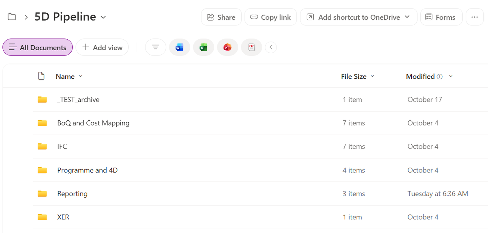
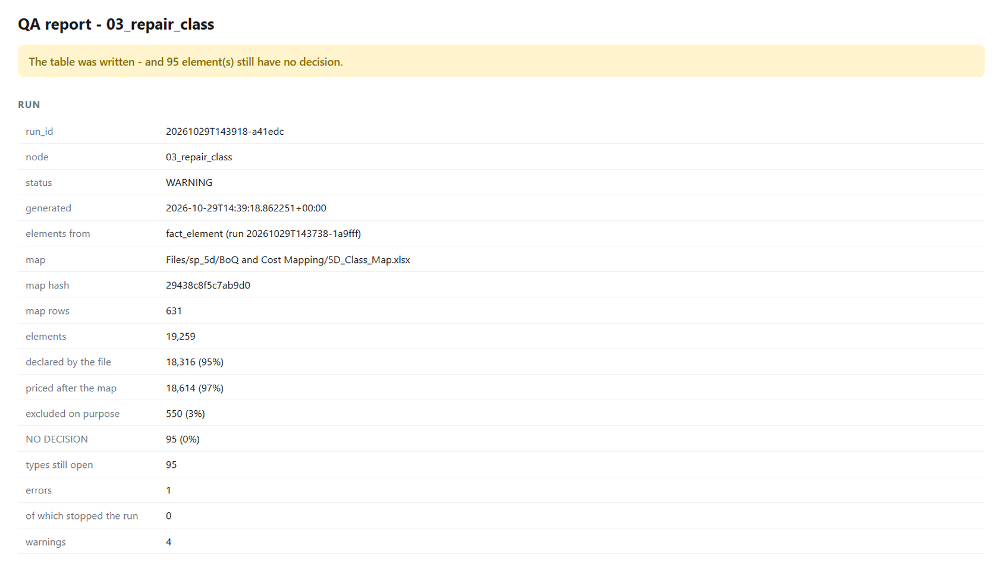
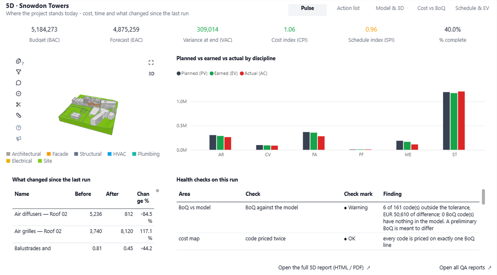
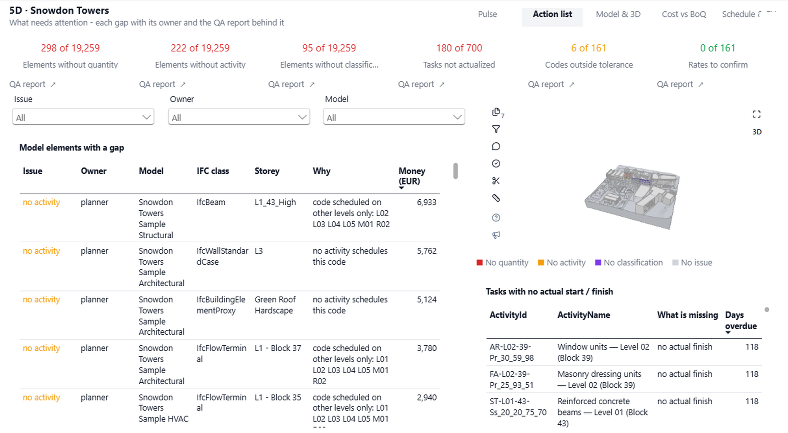

# Automated 5D pipeline overview

The automated 5D pipeline takes three things your project already produces, the IFC models, the bill of quantities (BoQ), and the programme, and turns them into one live picture of cost and progress. You save the files in SharePoint. The pipeline checks them against each other, publishes the results, and tells you exactly what to fix.

This article explains what the pipeline does at each stage and how to read its results.

<iframe title="ifcviewer_5D_pipeline" style="width: 100%; aspect-ratio: 16 / 9;" src="https://app.powerbi.com/view?r=eyJrIjoiMzlhMDc3OTEtZTkwZC00Nzk0LTk2MWItNmMyOGQ3MTcyYjkwIiwidCI6IjQ0YjY0MGYzLTQ5YjAtNDMwNC05Yzk4LWM2MWQwYmMwZGMwMiJ9" frameborder="0" allowFullScreen="true"></iframe>

<video controls style="width: 100%; max-width: 960px; border-radius: 6px; margin: 12px 0;">
  <source src="/_media/5d-pipeline-overview.mp4" type="video/mp4">
  Your browser does not support the video tag.
</video>

The video is an eight-minute walkthrough of the full pipeline, from the input folders to the report pages.

## How the pipeline works

The pipeline has three stages:

1. The team saves the models, the cost plan, and the programme in SharePoint.
2. The pipeline runs in Microsoft Fabric. It reads the files, measures the models, matches them to the cost plan and the programme, and checks the results.
3. The reports, the QA reports, and the Power BI dashboard come back to SharePoint.

One classification code links the three inputs. Every BoQ line carries a Uniclass code, and the same code on a model element tells the pipeline which rate prices it. The programme uses the same code to say which activity delivers the work.

## Save the inputs in SharePoint

The team keeps working the way it always does. The only change is where the files are saved. Each input type has its own folder in the project's SharePoint library.

| Input | What to save | Notes |
|---|---|---|
| IFC models | One IFC file for each discipline, such as architecture, structure, facades, and building services | Each element needs a classification code, a storey, and its quantities. |
| Bill of quantities | The current BoQ workbook | Every priced line carries a Uniclass code. To update the cost plan, save the new version in the same folder. |
| Programme | The Primavera P6 export (`.xer`) | Activities carry a cost code, dates, percent complete, and actual cost to date. |

To update the report, save a new or changed file in its folder. You don't need to start anything.

## When the pipeline runs

The pipeline starts by itself. A watcher checks the SharePoint folders every 15 minutes. If a model, the BoQ, or the programme is new or changed, it starts a full run. If nothing has changed, it does nothing.

A full run takes about 20 minutes. Every step is logged, so you can always see what ran and when. Within an hour of saving a file, the cost, the schedule, and the models are checked against each other and the dashboard is up to date.

## How each step reports its result

Every step in the pipeline follows the same pattern. It writes its own table, a QA report, and a verdict.

| Verdict | What happens |
|---|---|
| OK | The next step starts. |
| Warning | An email lists what to fix, and the run carries on. |
| Error finding | A data problem, such as elements with no classification, is recorded and emailed, and the run carries on. You get the full list of problems in one go. |
| Hard stop | A fault that would make every number after it wrong, such as a model in the wrong units. A failure email is sent, and the steps after it don't run, so bad numbers never reach the dashboard. |

## Pipeline steps

The steps run in a fixed order. Each one builds on the result of the step before it.

### Read the cost plan and the programme

| Step | What it does |
|---|---|
| Read the cost plan | Reads the BoQ and keeps one rate for each classification code. It keeps the BoQ quantities apart, so you always know whether a quantity came from people or from the model. Withdrawn Uniclass codes are translated to the current code, and the BoQ's own rekey sheet always wins. It checks that every code is a real Uniclass code, has a rate, and is priced only once. If the file can't be read, the run stops. |
| Read the programme | Reads the activities, dates, percent complete, and actual cost from the Primavera P6 export. It picks the latest programme by the data date inside the file, and skips test and draft files. It checks that activities carry a cost code and that dates and progress make sense. |

### Measure and price the models

| Step | What it does |
|---|---|
| Take off from the IFC models | Lists every element in every model with its class, type, storey, declared quantities, and classification code. If a file carries two classification systems, it reads the Uniclass one. It checks the units of every file first, and a model in the wrong units stops the run. It also prepares the models for the 3D viewer in Power BI. |
| Give every element a cost decision | Makes sure every element is either priced with a code or excluded on purpose, such as openings and spaces. Where the model gives no code, it fills the gap from the class map by family and type. It never overwrites a code that the model declares, and it never edits the IFC file. |
| Measure every priced element | Measures each element in the unit of its BoQ line: a count for items, a length for metres, an area for square metres, a volume for cubic metres, and volume times density for tonnes. If the model doesn't declare a quantity, it falls back to the axis length and then the property sets, and converts imperial units where needed. It makes sure nothing is measured twice, such as pipe fittings. |
| Compare the BoQ with the model | Puts the BoQ quantity and the model quantity side by side for every cost code. Each code is banded as within tolerance, model higher, model lower, or no BoQ quantity. This step only reports, because a preliminary BoQ is meant to differ. |

### Link to the programme and calculate earned value

| Step | What it does |
|---|---|
| Link elements to the programme | Links each element to one activity, first by storey, matched to the programme's level and block, and then by classification code. It never guesses an activity on another level. Elements with no storey, or with a code that no activity schedules, are reported. |
| Assign quantity and cost to activities | Gives each activity its model quantity and money. |
| Calculate earned value | Calculates planned value, earned value, and actual cost. From them it calculates the Cost Performance Index (CPI), the Schedule Performance Index (SPI), and the forecast, for every activity, block, discipline, and the whole project. |

### Check and publish

| Step | What it does |
|---|---|
| Record what changed | Records what changed since the last run. |
| Run self-checks | Checks that the numbers tie from one step to the next, that every step ran on this run, that no code is priced twice, and that no priced element is missing a rate. |
| Build the action list | Gathers every element that isn't fully priced and scheduled into one list, with the issue, the reason, who fixes it, and what it's worth. |
| Publish | Publishes the 5D report, adds a line to the KPI history, and copies all QA reports to SharePoint. |

## Read a QA report

Each step saves its QA report in SharePoint, in one folder for each step. For every run there's an HTML report and a CSV file of the gaps that you can open in Excel.

The first line of the report gives the verdict in plain words. Below it are the numbers for the run, such as how many elements came classified from the file, how many the class map priced, and how many were excluded on purpose.

Further down, the report lists every element type that still needs a decision, with one element ID that you can open in the model, and every check with its severity.

To fix a gap, the modeller fixes the type in the model, or a row is added to the class map. The next run picks up the change automatically.

## Review the results in Power BI

The results come back to SharePoint on one reporting page that the whole team can open, with no special software. The report has five pages.

| Page | What it shows |
|---|---|
| Pulse | Where the project stands today: the budget, the forecast, CPI and SPI, and planned, earned, and actual cost by discipline. It also shows what changed since the last run and the health checks for this run. |
| Cost vs BoQ | The BoQ compared with what the model measures, code by code. Green is within tolerance. Amber and red need a closer look. Select a line to see the elements behind that number in the 3D viewer. |
| Model & 3D | How complete the models are: how many elements are classified, measured, and priced for each discipline. |
| Schedule & EV | The programme, with the activities and blocks that are falling behind. |
| Action list | Every gap as a task, with its owner and reason. |

## Work through the action list

The action list turns every gap into a task, so the team knows exactly what to fix before the next run.

Across the top, the page counts the elements without a quantity, without an activity, or without a classification, the tasks that aren't actualized, and the codes outside tolerance. Each count links to its QA report. Below, every element with a gap shows its owner, model, IFC class, storey, reason, and the money it affects. Select a row to see where the element is in the 3D viewer.

The owner tells you who fixes each gap:

| Owner | Typical fix |
|---|---|
| Modeller | Add the missing classification, storey, or quantity in the authoring model and export the IFC file again. |
| Planner | Add or update the activity that schedules the code, or record the actual start and finish. |
| Cost manager | Add the missing rate or code to the BoQ, or review a code outside tolerance. |

Save the corrected file in its SharePoint folder. The next run checks it and updates the dashboard.

## Related content

- [Power BI semantic models](IFC_SharedSemanticModel.md)
- [4D construction dashboard](xref:IFC_4DPlanning)
- [Use the 3D IFC Viewer with Power BI](ifc-viewer-usage-for-power-bi.md)
